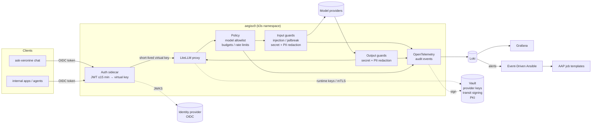
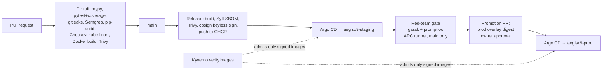

# AegisX9

<!-- Project id: aegisx9. Public domain (planned): aegisx9.com -->

**The security gateway for AI-driven development.** AegisX9 controls what AI does in
software delivery, and gives DevOps, developers and security one view of it: which builds,
pull requests and other changes AI is making or has made, who approved them, and with which
short-lived credentials. It is designed for small, medium and large organisations.

It has two enforcement points and one authority:

- **LLM gateway:** every model call passes through it. It authenticates callers with
  short-lived tokens, applies input and output guards, enforces model allowlists, budgets and
  rate limits, and writes an audit trail that never stores secret values.
- **Build and action gate:** every change an agent or person wants to make (a pull request,
  a build, a deployment, an infrastructure action) is classified by typed policy and either
  passes, or waits for a hardware-key-signed approval that is bound to that exact change.
- **Approval governance:** who may approve, how many approvers are needed, emergency
  (break-glass) rules, notifications and log routing are all configurable, and changing that
  policy is itself a signed, multi-approver change.

Secrets are always short-lived and, where possible, single-use. AegisX9 watches continuously
for attempts to get around the gate. It is built and operated the way a large enterprise
product would be: issue-driven, trunk-based, signed supply chain, GitOps delivery and a
continuous red-team gate.

> **Status:** Phase 1 (LLM gateway, guards, CI/CD) in progress. Version `0.4.1`. The build
> and action gate is designed (ADRs 0011-0020) and starts with GitHub.
>
> **Docs:** maintained in a private documentation system; public copies will follow.

## Why

Teams adopting LLMs need one choke point where security and governance controls apply
consistently: who may call which model, what may go in and out, what it costs, and a
record of what happened. aegisx9 is that choke point, together with the evidence (control
mappings, risk register, red-team results) that an AI governance programme needs.

## Architecture



### Delivery pipeline



### Platform stack

| Concern | Tool |
|---------|------|
| Infrastructure as code | Terraform, run in Terraform Enterprise (CLI-driven from in-cluster runners) |
| Policy as code | Sentinel (infrastructure), Kyverno (admission) |
| Secrets, signing, certificates | Vault: runtime provider keys, transit-signed audit records, PKI for mTLS |
| Day-2 operations and response | Ansible Automation Platform + Event-Driven Ansible |
| Delivery | GitHub Actions, GHCR, cosign, Argo CD |

## Roadmap

| Phase | Scope |
|-------|-------|
| 1 | LLM gateway behind short-lived OIDC tokens; input/output guards; model allowlist, budgets, rate limits; OpenTelemetry audit log; full CI/CD and red-team gate; external scanner |
| 1.5 | Developer workspaces: signed workspace image, Vault-issued short-lived developer tokens, centralised workspaces |
| 2 | **Build gate for GitHub (core):** approval service (typed policy-as-code, N-of-M, separation of duties, break-glass, hardware-key WebAuthn console); GitHub App with required checks, rulesets and deployment protection; build and change audit trail; short-lived secrets broker, where agents hold only session-bound handles (exchanged for a single-use broker token per request) and never a real credential, plus per-project service identities ([ADR 0015](docs/adr/0015-brokered-agent-credentials-and-project-identities.md)); bypass detection |
| 3 | **Jira and change management:** issue and release links, service-desk approvals as workflow (never authority), Jira ↔ PR ↔ request ↔ approval ↔ deployment trail |
| 4 | Tool/action gateway for agents (MCP): per-agent tool allowlists, per-action credentials, approval for risky actions |
| 5 | Connector framework: capability matrix and trust bar; GitLab, Bitbucket, Azure DevOps, Forgejo; ServiceNow, Linear; Slack, Teams, PagerDuty; Okta, Entra; Splunk, Sentinel, Datadog, Elastic |
| 6 | Governance pack and dashboards: control mapping (OWASP LLM Top 10 2025, MITRE ATLAS, NIST AI RMF + AI 600-1), AI system inventory, risk register, ISO/IEC 42001-style policy; admin console grows each phase |

Work is tracked in GitHub Issues, Milestones and a Projects board.

## Repository layout

| Path | Contents |
|------|----------|
| `src/aegisx9/` | Guard pipeline, guards, audit-event schema, audit signing (Vault transit), policy, LiteLLM hook adapter, Workload Identity Federation broker for the model provider (no static key; [ADR 0009](docs/adr/0009-workload-identity-federation-for-the-model-provider.md)), budget jobs and the federation signing-key check (`wif.uploadedKids`) |
| `Dockerfile` | Gateway image: LiteLLM proxy with the Prisma client, CLI, engines and Node.js baked in, so database migrations need no network and the root filesystem stays read-only |
| `tests/` | Unit tests (coverage gate 85%) |
| `deploy/helm/aegisx9/` | Helm chart (LiteLLM proxy, config, NetworkPolicy, restricted PodSecurity) |
| `deploy/overlays/{staging,prod}` | Kustomize overlays consumed by Argo CD |
| `deploy/argocd/` | Argo CD `Application` manifests |
| `policies/kyverno/` | Admission policy: only keyless-signed images from this repo's `main` |
| `policies/sentinel/` | Sentinel policy set enforced on every Terraform Enterprise run, with mock-based tests |
| `infra/` | Terraform roots (`staging`, `prod`) run in Terraform Enterprise: namespaces, quotas, Vault (KV, transit, PKI), identity-provider app, GitHub settings, Route 53 |
| `automation/`, `extensions/eda/` | Ansible collection and playbooks for Ansible Automation Platform; Event-Driven Ansible rulebooks |
| `redteam/` | promptfoo and garak suites run against staging |
| `scanner/`, `infra/scanner/` | External vantage: daily exposure, TLS, DNS and uptime checks of the public surface from a cloud host, diffed against the approved-exposure registry; the host's Terraform and hardened systemd units (see `scanner/README.md`) |
| `workspace/` | Signed developer workspace image with the locked Claude Code baseline, hooks, `apiKeyHelper` and handoff tooling |
| `docs/adr/` | Architecture decision records |

## Developer workspaces

Developers use centralised workspaces (one signed, digest-pinned image per pod) in
which Claude Code runs under a locked, root-owned policy baseline: gateway-only
routing, a Vault-issued short-lived token instead of any static key, a Bash sandbox,
fail-closed hooks and a daily handoff routine. See [workspace/README.md](workspace/README.md).

## Local development

```bash
python3 -m venv .venv && . .venv/bin/activate
pip install -e '.[dev]'
ruff check . && ruff format --check . && mypy && pytest
helm lint deploy/helm/aegisx9
terraform fmt -check -recursive infra
(cd policies/sentinel && sentinel test)
ansible-lint
```

## Security

See [SECURITY.md](SECURITY.md) for vulnerability reporting and the CI runner policy.

## License

Apache License 2.0. See [LICENSE](LICENSE).
