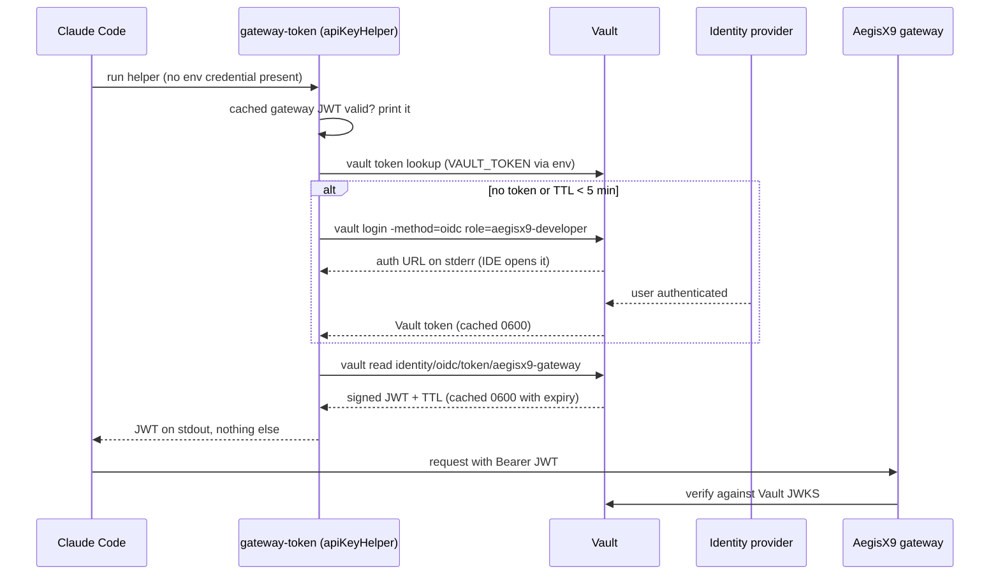

# AegisX9 developer workspace

Developers work in centralised, per-developer workspaces (Coder on Kubernetes). Each
workspace is one pod running **one signed, digest-pinned image** built from this
directory. The image bakes in a **locked Claude Code policy baseline** as root-owned
files that the `dev` user cannot change. Laptops hold only an IDE client (VS Code
Remote-SSH, JetBrains Gateway) and the VPN. All model traffic goes to the AegisX9
gateway; **no static API key exists anywhere**.

| Path in the image | Source | Purpose |
|---|---|---|
| `/etc/claude-code/managed-settings.json` (root, 0644) | `image/managed-settings.json` + `image/workspace.env` | The locked baseline (rendered at build time) |
| `/etc/claude-code/managed-mcp.json` (root, 0644) | `image/managed-mcp.json` | Exclusive MCP server list (empty: MCP disabled) |
| `/etc/aegisx9/workspace.env` (root, 0644) | rendered | The resolved site values, for tooling; no secrets |
| `/opt/aegisx9/hooks/*` (root, 0755) | `image/hooks/` | Fail-closed hooks: regex-only prompt credential check, Bash guard, session-end handoff |
| `/opt/aegisx9/bin/gateway-token` (root, 0755) | `image/bin/gateway_token.py` | The `apiKeyHelper`: Vault-issued, short-lived gateway token |
| `/opt/aegisx9/bin/handoff` (root, 0755) | `image/bin/handoff.py` | Daily handoff note CLI |
| `/opt/aegisx9/bin/workspace-init` | `image/bin/workspace-init.sh` | Per-login init (unsets static keys, links the skill) |
| `/opt/aegisx9/bin/workspace-selftest` | `image/bin/workspace-selftest.sh` | Baseline integrity check (CI and `HEALTHCHECK`) |
| `/opt/aegisx9/claude/skills/handoff/SKILL.md` | `claude/skills/handoff/SKILL.md` | The end-of-session skill |

## The baseline, in one table

| Control | Setting |
|---|---|
| Gateway only | `allowedProviders: ["customEndpoint"]`, `forceLoginMethod: "gateway"`, `env.ANTHROPIC_BASE_URL` = the gateway |
| No static credential | `apiKeyHelper: /opt/aegisx9/bin/gateway-token`; the image never sets a provider key or auth token, `workspace-init` unsets them at login, the Bash guard refuses commands that set them |
| Model policy | `availableModels`, `deniedModels`, `enforceAvailableModels: true` |
| Permissions | `defaultMode: default`, bypass and auto modes disabled, reads outside the working directory blocked, secret paths denied, `WebFetch`/`WebSearch`/`curl`/`wget`/`sudo` denied; only managed rules, hooks and MCP servers count |
| Sandbox | enabled, `allowUnsandboxedCommands: false`, `failIfUnavailable: true`, network allowlist = gateway + OTLP + Vault + `AEGISX9_SANDBOX_DOMAINS`; `denyRead` mirrors the Read denies (`**/.env`, `**/.env.*`, `**/secrets/**`, `**/*.pem`, `**/*.key`, home credential paths) so shell globbing cannot read them |
| Hooks | `UserPromptSubmit` (regex-only credential check, `image/hooks/credential-patterns.txt`), `PreToolUse(Bash)`, `SessionEnd`; every hook has `onFailure: block` and exits 2 with a one-line reason; nothing sensitive is ever echoed. Hooks and the `handoff` CLI read only the managed files under `/opt/aegisx9` (no environment override); a missing or empty pattern file blocks |
| Telemetry | OTLP metrics and logs to `AEGISX9_OTLP_ENDPOINT`; `OTEL_LOG_USER_PROMPTS` and `OTEL_LOG_TOOL_DETAILS` are set to `0` explicitly so prompt text and tool details are never exported |
| Hygiene | `cleanupPeriodDays: 7`, connectors and remote control off, stable update channel, nonessential traffic and feedback disabled |
| Agent rules | `claudeMd`: never print secrets, no secrets on argv, exception type names only, no credential-shaped literals, write the handoff note |

Unverified setting and variable names (`DISABLE_AUTOUPDATER`, `CLAUDE_CODE_MCP_ALLOWLIST_ENV`)
are deliberately **not** in the enforced file; add them once confirmed against the docs.

**Secret detection, where it is authoritative.** The prompt hook is a fast local regex
check only (a developer convenience that fails closed on script errors). The
**AegisX9 gateway's input guard** is the authoritative secret and PII detection: every
request passes through it regardless of what runs in the workspace. The image carries
no gitleaks binary (upstream releases are built with an old Go toolchain and fail the
image CVE gate); the repository's own CI still runs gitleaks on the code.

## How site values get in (and why at build time)

Managed settings are static JSON and the container runs as the unprivileged `dev`
user, so nothing can rewrite `/etc/claude-code` after start. The gateway URL, OTLP
endpoint, Vault address and model lists are therefore rendered **at image build time**
by `image/render_settings.py` from `image/workspace.env` plus Docker build args of the
same names. The signed digest then attests the whole baseline, configuration included;
changing a value means building and signing a new image, which is the point.

```bash
docker build workspace -f workspace/image/Dockerfile \
  --build-arg AEGISX9_GATEWAY_URL=https://<gateway-host> \
  --build-arg AEGISX9_OTLP_ENDPOINT=https://<otlp-host> \
  --build-arg AEGISX9_VAULT_ADDR=https://<vault-host> \
  --build-arg AEGISX9_MODELS=<model-a>,<model-b> \
  -t aegisx9-workspace:local
docker run --rm aegisx9-workspace:local /opt/aegisx9/bin/workspace-selftest
```

The build refuses placeholders. In CI the image is built with `example.test` hosts and
self-tested; the release build on `main` reads GitHub **repository variables**
`AEGISX9_GATEWAY_URL`, `AEGISX9_OTLP_ENDPOINT`, `AEGISX9_VAULT_ADDR` (and optionally
`AEGISX9_ENVIRONMENT`, `AEGISX9_MODELS`, `AEGISX9_DENIED_MODELS`,
`AEGISX9_SANDBOX_DOMAINS`) and is **skipped until they are set**. Platform-side
overrides that need no rebuild can be mounted read-only by the workspace template into
`/etc/claude-code/managed-settings.d/` (a ConfigMap volume is root-owned), which the
developer cannot write either.

## Credential flow (`gateway-token`)



- Credential precedence in Claude Code is `ANTHROPIC_AUTH_TOKEN` > `ANTHROPIC_API_KEY` >
  `apiKeyHelper`, so the image guarantees neither variable is set.
- `CLAUDE_CODE_API_KEY_HELPER_TTL_MS` (55 min) keeps Claude Code from calling the helper
  more than needed; the helper's own cache makes extra calls cheap.
- The browser hand-off: Vault's OIDC CLI listens on `localhost:8250` inside the
  workspace. VS Code Remote-SSH forwards the port automatically when the URL appears in
  the terminal; JetBrains Gateway needs a port-forward rule for 8250.
- Vault side (Terraform, `infra/`, pending): OIDC auth role `aegisx9-developer`, an
  identity OIDC provider role/key `aegisx9-gateway` (1 h tokens, claims bound to the
  entity), and the gateway configured with Vault's JWKS as a second JWT issuer (#49).

## Memory and handoff (#51)

| Mount | Path in the pod | Holds |
|---|---|---|
| Per-developer home volume (PVC, RWO) | `/home/dev` | `~/.claude/` (session store, skills link), `~/.aegisx9/handoff/` (daily notes), `~/.aegisx9/vault-token` and `gateway-token.json` (0600 caches), repos |
| Team memory (shared volume or a service mount, RWX; reachable only from workspaces) | `$AEGISX9_TEAM_MEMORY_DIR`, suggested `/workspace/team-memory` | `<user>/YYYY-MM-DD.md` copies published with `handoff publish` |

- `handoff add changed|open|tomorrow "..."` appends bullets; `handoff show` prints
  today's note; `handoff publish` copies it to team memory. Every bullet (and the whole
  note on publish) is checked against the same secret patterns as the prompt hook.
- The `SessionEnd` hook calls `handoff stub` so a note exists for every day a session
  ended, with the session id and a reminder when nothing was written.
- The `/handoff` skill (`claude/skills/handoff/SKILL.md`) is linked into
  `~/.claude/skills/` at login by `workspace-init`.
- Memory stores on the home volume should be scanned by the same detectors as code; a
  nightly scan job in the workspace template (its own scanner image, not this one) over
  `~/.claude` and `~/.aegisx9` is the intended mechanism (not in this repo).

## Runtime requirements for the workspace template

- Run as uid 1000 (`dev`), read-only root filesystem is fine (`/tmp` and `/home/dev`
  writable), no privilege escalation, no sudo.
- The Bash sandbox uses bubblewrap: the pod needs unprivileged user namespaces (or a
  seccomp/AppArmor profile that allows them). With `failIfUnavailable: true` Claude Code
  refuses to run Bash without the sandbox rather than running unsandboxed.
- Network policy: egress to the gateway, OTLP collector, Vault, the git host and the
  package registries only.
- SSH and sync: the Coder agent's startup script starts `sshd` **unprivileged, as
  `dev`, on a loopback port**, with host keys kept on the home volume (the image never
  generates them); the sync tool connects over it as `dev` with `rsync`. The image ships
  `openssh-server`, `rsync`, `procps` (pod probes use `pgrep`) and `python3` for this;
  `image/sshd/aegisx9.conf` applies the hardening (no passwords, no root, loopback).

## Testing

`tests/workspace/` covers the rendered settings (every control present, no credential
slot), the hooks (block versus allow with crafted stdin, fail-closed paths), the
`gateway-token` helper against a fake `vault` on `PATH`, and the `handoff` CLI. CI also
builds the image and runs `workspace-selftest` plus external assertions inside it.
